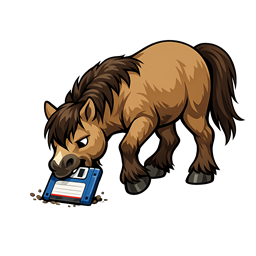
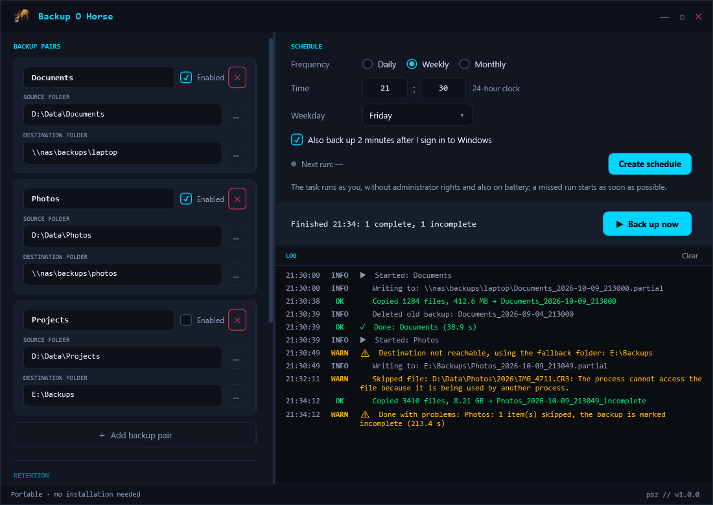
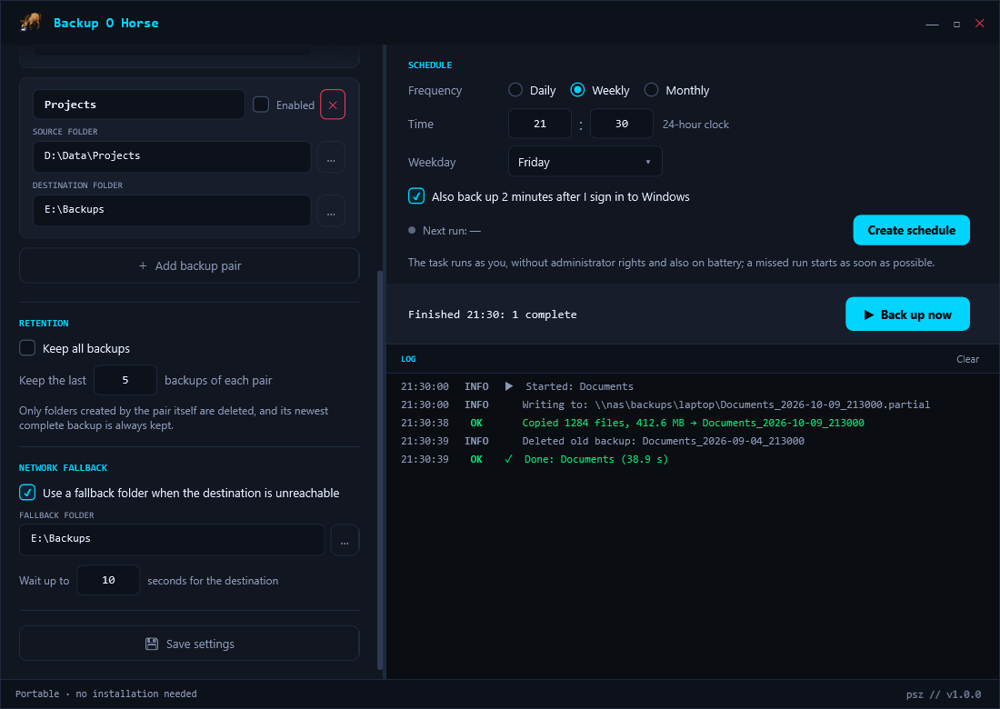
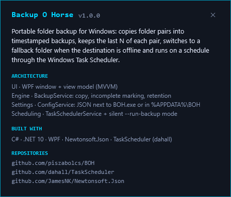
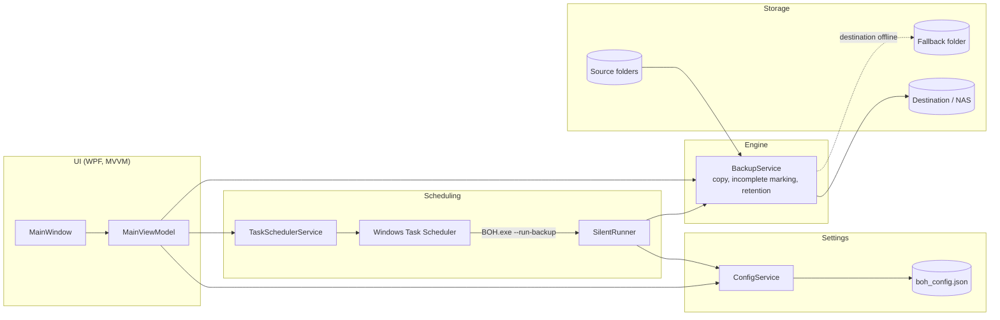

<div align="center">



# Backup O Horse (BOH)

**Scheduled folder backups for Windows that never pass off a half-finished copy as complete**


[Features](#features) · [Screenshots](#screenshots) · [Architecture](#architecture) · [Installation](#installation)

</div>

<p align="center">
  
</p>

## The problem

Copying a few folders to a NAS or an external drive by hand is easy to forget, and a plain copy script has
blind spots: a run that stops halfway leaves a folder that looks like a finished backup, a locked file
silently goes missing, old backups pile up until the disk is full, and nothing happens at all when the NAS
is switched off.

## The solution

BOH is a single portable `BOH.exe` that copies folder pairs (source to destination) into timestamped backup
folders. A backup is written under a `.partial` name and renamed only when the copy has finished, so an
interrupted run can never pass for a good one. It keeps the last N backups of each pair, switches to a
fallback folder when the destination does not answer, and runs on a schedule through the Windows Task
Scheduler under your normal user account.

## Features

- **Backup pairs.** Any number of source to destination pairs; each run creates `<destination>\<pair name>_<yyyy-MM-dd_HHmmss>`.
- **Honest results.** Locked or unreadable files are retried once, then skipped and listed in the log, and such a backup is kept as `_incomplete`; a cancelled or failed backup is removed.
- **Safe retention.** Keeps the last N backups per pair (or all); only folders carrying the pair's `.boh-backup.json` marker are deleted, never the newest complete one, and nothing is deleted after a failed run.
- **Network fallback.** When the destination drive or share does not answer within the timeout, the backup goes to a fallback folder instead.
- **Scheduling without admin rights.** Daily, weekly or monthly, optionally also 2 minutes after sign-in; the task runs as you, also on battery, and a missed run starts as soon as possible.
- **Input checks.** Pair names must be unique and valid folder names, a destination inside its own source is refused, and junctions or symbolic links inside a source are skipped and logged.
- **Portable mode.** A `boh_config.json` next to `BOH.exe` keeps settings and the log on the same USB stick.
- **Silent command-line run.** `BOH.exe --run-backup` backs up all enabled pairs without a window and returns an exit code.

## Screenshots

<table>
  <tr>
    <td align="center" width="50%"><br/><sub>Retention and network fallback settings</sub></td>
    <td align="center" width="50%"><br/><sub>About card opened from the footer signature</sub></td>
  </tr>
</table>

The images are rendered off-screen from demo data by the GUI smoke test (no window is shown), see
`BOH.Tests/WindowRenderTests.cs`.

## Architecture



`Program.Main` decides the mode: with `--run-backup` it calls `SilentRunner` without creating any WPF object,
otherwise it starts the window. Both paths load the same settings through `ConfigService` and run the same
`BackupService`, which copies each enabled pair, marks the result and applies retention. `TaskSchedulerService`
only writes the task definitions; the Windows Task Scheduler then starts `BOH.exe --run-backup` on time.

## Tech stack

| Layer | Technology |
|---|---|
| Language and runtime | C#, .NET 10 (`net10.0-windows`) |
| UI | WPF, MVVM, custom dark theme |
| Settings | JSON via Newtonsoft.Json |
| Scheduling | Windows Task Scheduler via the TaskScheduler library |
| Tests | xUnit, off-screen WPF rendering |
| CI and packaging | GitHub Actions, self-contained single-file `win-x64` publish |

## Installation

Prerequisites: Windows 10 or 11 (x64) and the [.NET 10 SDK](https://dotnet.microsoft.com/download).
`BOH.slnx` opens in Visual Studio 2022 17.13 or later.

1. Clone the repository:
   ```powershell
   git clone https://github.com/piszabolcs/boh.git
   cd boh
   ```
2. Run the tests:
   ```powershell
   dotnet test BOH.slnx
   ```
3. Start the app:
   ```powershell
   dotnet run --project BOH.csproj
   ```
4. Build the portable single-file exe (no .NET installation needed on the target PC):
   ```powershell
   dotnet publish BOH.csproj -p:PublishProfile=win-x64
   ```
   The result is `bin\publish\win-x64\BOH.exe`.

## Usage

1. Add a backup pair, pick the source and destination folders, then set retention and, if the destination
   is a NAS, a fallback folder.
2. Click **Back up now** (F5) for a first run and check the log; **Esc** stops a running backup.
3. Choose a frequency and time, then click **Create schedule**. Save with **Save settings** (Ctrl+S): a
   scheduled run uses the saved settings, "Back up now" uses the ones on screen.

Settings and the log of scheduled runs are stored in `%APPDATA%\BOH\` (`boh_config.json`, `boh_log.txt`), or
next to `BOH.exe` when a `boh_config.json` already sits there (portable mode). A damaged settings file is kept
as `boh_config.json.bad-<timestamp>` and the defaults are loaded.

`BOH.exe --run-backup` exit codes: `0` every enabled pair was backed up completely, `1` at least one pair
failed or is incomplete, `2` unusable settings, no enabled pair or an unexpected error.

The scheduled tasks are called `BOH_AutoBackup` and `BOH_Startup`. Remove them with **Remove schedule** before
deleting `BOH.exe`, or from a command prompt:

```powershell
schtasks /delete /tn BOH_AutoBackup /f
schtasks /delete /tn BOH_Startup /f
```

Security notes: BOH stores no passwords; for a network destination use a UNC path (`\\server\share\folder`)
that your Windows account can already open. Scheduled tasks run with your normal rights. Versions before 1.0.0
created them with the highest privileges; if such a task still exists, delete it from an administrator command
prompt and create the schedule again.

Limitations: every backup is a full copy (no incremental mode), open files are not read through Volume Shadow
Copy, backups made before 1.0.0 have no marker and are never deleted automatically, and renaming a pair starts
a new series.

## Project structure

```text
boh/
├── Program.cs           # entry point: --run-backup runs silently, otherwise the WPF app
├── App.xaml             # application resources and the dark theme
├── AppInfo.cs           # name and version for the footer signature and About card
├── Models/              # backup pair, settings and result types
├── Services/            # copy engine, settings, silent runner, task scheduler
├── ViewModels/          # MainViewModel and commands
├── Views/               # main window, About card, scroll fade
├── Converters/          # WPF value converters
├── Assets/              # app icon and logo
├── Properties/          # launch settings and the win-x64 publish profile
├── BOH.Tests/           # xUnit tests, including the off-screen UI render
├── docs/                # logo and README screenshots
└── .github/workflows/   # build, test and publish on Windows
```

## Roadmap

- [ ] Incremental or hard-link backups so unchanged files are not copied again
- [ ] Read open files through Volume Shadow Copy instead of skipping them
- [ ] Ready-to-download `BOH.exe` on the GitHub Releases page

## License

MIT, see [LICENSE](LICENSE). Third-party packages: [Newtonsoft.Json](https://github.com/JamesNK/Newtonsoft.Json)
(MIT) and [TaskScheduler](https://github.com/dahall/TaskScheduler) by David Hall (MIT).

---

<div align="center">
<sub>Built by Szabolcs Pintér · <a href="https://github.com/piszabolcs">GitHub</a> · <a href="https://www.linkedin.com/in/piszabolcs">LinkedIn</a></sub>
</div>
